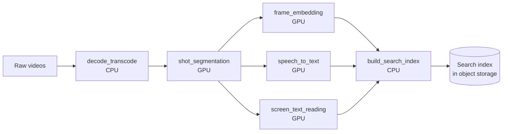
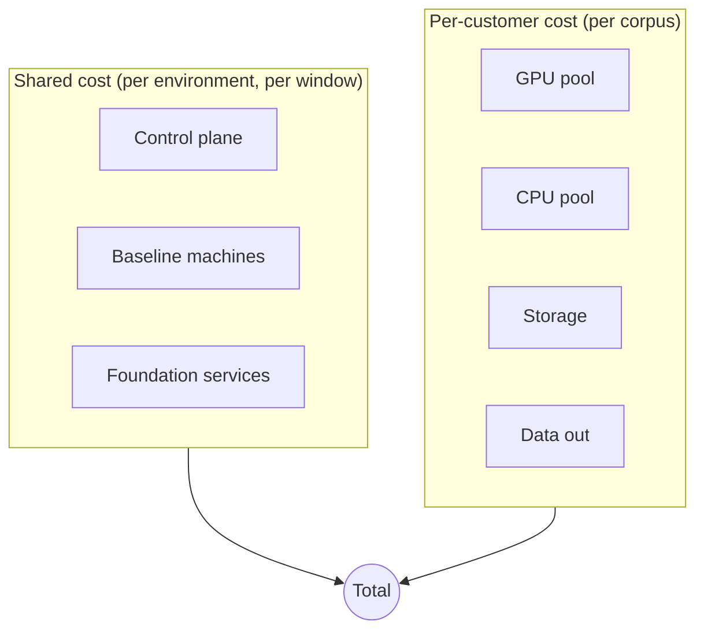
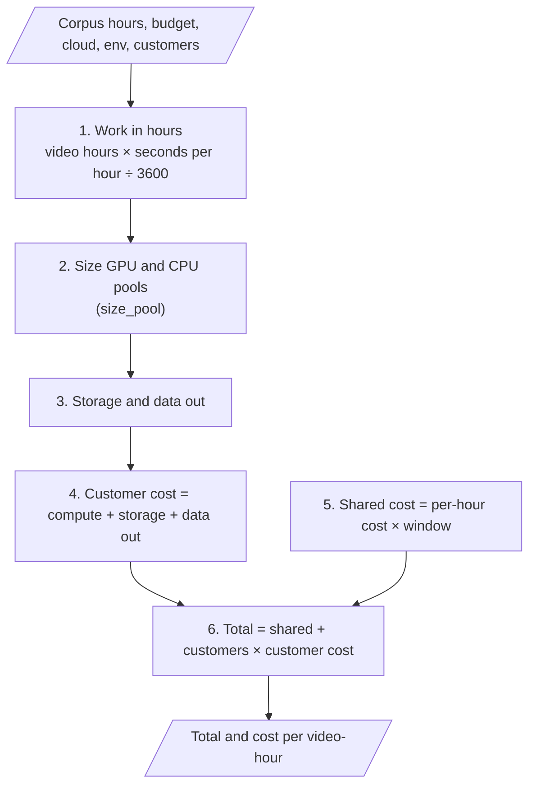

# Architecture

This document covers what the calculator models, how a result is produced,
and why the design is the way it is.

## 1. The pipeline being costed

Each video goes through the same stages. Some video types skip or partly run
a stage.

## 2. What is being costed

- **Shared cost** is paid for each environment (dev, qa, preprod, prod)
  whether or not a customer is running. It does not depend on corpus size.
- **Per-customer cost** exists only because a corpus is being processed.

## 3. Calculation flow

`estimate()` in `src/calculator.py` runs these steps in order. The comments in
the code use the same numbers.

`size_pool()` works in three sub-steps:

- **A. Busy hours** = work ÷ (units per machine × usable share). The usable share is 65%.
- **B. Machines** = round up (busy hours ÷ budget hours). This is how many run at once.
- **C. Billed hours** = busy hours + startup time for each machine.

## 4. Limits

- Prices are typed into the config. Live prices are not fetched.
- Stage timings are placeholders. They must be measured on the real models.
- Machines are sized with a simple rounding rule, not a queue simulation.
- Data out is a flat number of GB per customer.

## 5. Results from the default sweep

These use placeholder numbers, so they show the shape of the results, not real costs.

- Storage is most of the per-customer cost. For 10,000 hours on AWS over 24
  hours, storage is about $3,450 of about $4,560 per customer. Compute is about
  $1,100. Keeping data for 12 months is the main driver.
- Cost per video-hour falls as the corpus grows. On AWS over 24 hours it drops
  from about $4.80 at 100 hours to about $0.50 at 10,000 hours, because shared
  cost is spread across more video.
- For prod, shared cost is about $431 for a 24-hour window and about $1,294 for 72 hours.
